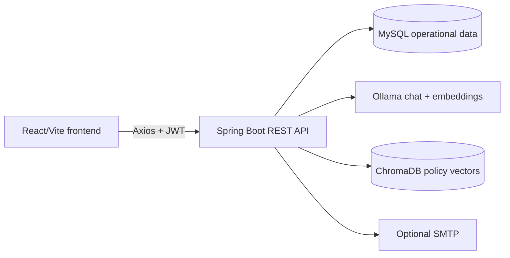
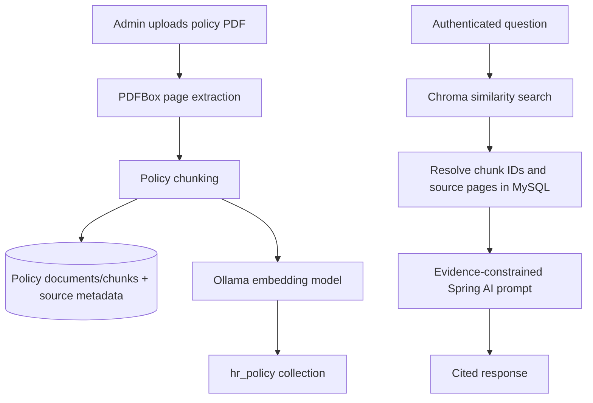

# AI-Powered Employee Leave Management System


An interview-friendly HR leave-management application with role-aware employee, manager, and administrator workflows. Leave requests, balances, approvals, audit records, notifications, and configuration are persisted in MySQL. An optional local Spring AI/Ollama assistant provides cited answers from uploaded HR policy PDFs.

> **Data-safety notice:** This repository is intended for development and portfolio use. Never point schema scripts, migrations, seed configuration, or test workflows at an existing deployment without a reviewed backup and change plan.

## Overview

LeaveFlow is a modular monolith consisting of a React/Vite client and a Spring Boot REST API. MySQL is the operational source of truth. ChromaDB stores only policy-document vectors; Ollama supplies chat and embedding models for the optional policy assistant.

## Key features

### Employee

- JWT login, current-user session handling, profile access, role-aware navigation, and BCrypt password storage.
- Apply for leave with weekend/holiday-aware working-day calculation and overlap checks.
- View leave history, current balances, balance transactions, notifications, and personal dashboard data.
- Cancel eligible pending or pre-start approved requests.

### Manager

- View and review requests from directly assigned employees only.
- Approve or reject requests with transactional balance accounting and audit records.
- View team leave activity and manager dashboard data without bypassing direct-report checks.

### Administrator

- Configure departments, leave types, holidays, employees, manager assignments, and entitlements.
- Review leave activity, reports, audit records, notifications, and all employee balances.
- Upload policy PDFs, list policy documents, and run idempotent policy reindexing.

### AI Assistant

- Answer policy questions using cited PDF evidence retrieved through ChromaDB.
- Use authenticated MySQL-backed tools for personal balance, leave-history, and holiday questions.
- Support deterministic, conversation-bound leave submission confirmation (`YES` submits; `NO` cancels).
- Keep policy ingestion page-aware and preserve private per-user chat history.
- AI cannot approve/reject leave, alter balances/roles/permissions, or execute SQL.

## Technology stack

| Layer | Technology |
| --- | --- |
| Frontend | React, Vite, React Router, Bootstrap 5, Context API, Axios |
| Backend | Java 21, Spring Boot 3.4.5, Spring Security, JWT, JPA/Hibernate, Validation, Lombok, Mail |
| Database | MySQL 8; Flyway migrations; `aiemployeeleavemanagementsystem` schema |
| AI/RAG | Spring AI, Ollama (`llama3.2`, `nomic-embed-text`), ChromaDB |
| Tooling | Maven, npm, Docker Compose, springdoc OpenAPI, Vitest/RTL |

## Architecture





## Project structure

```text
.
├── backend/
│   ├── src/main/java/com/mahesh/empleave/
│   │   ├── ai/              # policy ingestion, retrieval, chat, AI tools
│   │   ├── auth/            # login, registration, JWT-facing endpoints
│   │   ├── employee/        # employee administration and profiles
│   │   ├── leave/           # applications, approval, cancellation
│   │   ├── leavebalance/    # balances and accounting ledger
│   │   ├── department/      # departments and assignments
│   │   ├── holiday/         # company holidays
│   │   ├── notification/    # user notifications
│   │   ├── audit/           # audit records
│   │   ├── report/          # leave reports and trends
│   │   ├── dashboard/       # role-aware dashboard data
│   │   ├── security/        # Spring Security and JWT filter
│   │   └── common/          # shared DTOs and infrastructure
│   ├── src/main/resources/db/migration/
│   └── src/test/
├── frontend/src/            # pages, components, contexts, layouts, services
├── database/schema.sql      # reference schema for a new local database
├── docs/                    # project and user documentation
├── .github/workflows/ci.yml
├── .env.example
└── docker-compose.yml
```

## Local setup

### Prerequisites

- Java 21 and Maven
- Node.js/npm
- MySQL 8 with the `aiemployeeleavemanagementsystem` database
- Ollama with `llama3.2` and `nomic-embed-text` for live AI/RAG
- ChromaDB 1.5.9 for the verified local policy-vector setup

### Environment variables

Copy `.env.example` to an untracked local `.env` and replace every placeholder with local values. Spring Boot does not load `.env` automatically when launched directly; provide these variables through your shell or IDE. Docker Compose reads `.env`.

Required for the backend include `MYSQL_PASSWORD`, `MIGRATION_DB_PASSWORD`, and `JWT_SECRET`. Configure `MYSQL_DATABASE=aiemployeeleavemanagementsystem` and do not use the unrelated `employeeleavemanagementsystem` database. SMTP variables are optional. `INITIAL_ADMIN_EMAIL` and `INITIAL_ADMIN_PASSWORD` are used only when the existing admin-seed switch is enabled.

The frontend uses `VITE_API_BASE_URL` and defaults to `http://localhost:8080/api`.

### Start local services

The verified local ChromaDB setup uses a machine-local persistent directory and host port 8001:

```powershell
ollama serve
ollama pull llama3.2
ollama pull nomic-embed-text

chroma.exe run --path $env:CHROMA_PERSISTENT_DIR --host 127.0.0.1 --port 8001
```

Then start the application:

```powershell
docker compose up -d mysql

cd backend
mvn -B spring-boot:run
```

In another terminal:

```powershell
cd frontend
npm install
npm run dev
```

Open the frontend at `http://127.0.0.1:5175`. The backend listens on port 8080. Swagger is available at `http://127.0.0.1:8080/swagger-ui/index.html` (and `/swagger-ui.html`).

## Docker Compose

From the repository root, copy `.env.example` to `.env`, set the required database and JWT values, then run:

```powershell
docker compose up --build
```

| Service | Host port | Container port / URL |
| --- | ---: | --- |
| Frontend | 5175 | container HTTP port 80 |
| Backend | 8080 | 8080 |
| MySQL | 3306 | 3306 |
| ChromaDB | 8001 | 8000; backend uses `http://chroma:8000` |
| Ollama | 11434 | 11434 |

The Docker backend must use service names (`mysql`, `chroma`, and `ollama`) rather than `localhost`. The local verified setup uses ChromaDB 1.5.9 at `http://127.0.0.1:8001`. The Compose image is `chromadb/chroma:0.6.3`; compatibility of that image with this backend's Chroma V2 API has not been verified, so Docker RAG should not be treated as validated.

## AI assistant and RAG

Administrators upload policy PDFs with `POST /api/ai/policies`. PDFBox extracts page text, the ingestion service chunks it, Ollama generates 768-dimensional `nomic-embed-text` embeddings, and vectors are stored in the `hr_policy` Chroma collection. MySQL stores document metadata, chunks, page/source mappings, conversations, and vector IDs. `POST /api/ai/policies/{id}/reindex` repairs indexing for an existing document without recreating it.

Policy questions use retrieved evidence and return citations such as `file.pdf#page-3`. Personal balance, leave-history, and holiday questions use authenticated MySQL-backed tools; identity is derived from Spring Security, never from an employee ID supplied by the model. The assistant cannot approve/reject leave, alter balances/roles/permissions, or execute SQL. Pending leave submission uses a deterministic, conversation-bound confirmation flow (`YES` submits and `NO` cancels).

Live AI answers require reachable Ollama and ChromaDB plus an uploaded policy document. Missing or inconsistent indexing is reported separately from genuine insufficient policy evidence.

Google OAuth is optional for local JWT-based operation. If enabled, configure Google credentials and the callback path `/login/oauth2/code/google` in Google Cloud and provide the corresponding environment variables. OAuth and live external integrations are not verified by the repository's unit-test suite.

## Main APIs

All secured endpoints require the JWT returned by `POST /api/auth/login`.

| Area | Endpoints |
| --- | --- |
| Authentication | `POST /api/auth/login`, `GET /api/auth/me`, `POST /api/auth/logout`, `POST /api/auth/register` |
| Employees/departments | `/api/employees`, `/api/employees/me`, `/api/departments` |
| Leave configuration | `/api/leave-types`, `/api/leave-balances`, `/api/leave-balances/history` |
| Leave workflow | `POST /api/leaves`, `GET /api/leaves/my`, `PUT /api/leaves/{id}/approve`, `reject`, `cancel` |
| Reports/dashboards | `/api/reports/*`, `/api/dashboard/*` |
| Notifications/audit | `/api/notifications/*`, `/api/audit-logs` |
| Policy and AI | `POST /api/ai/policies`, `GET /api/ai/policies`, `POST /api/ai/policies/{id}/reindex`, `POST /api/ai/chat`, `/api/ai/conversations/**` |

API errors use a consistent timestamp/status/error/message/fields response shape. Swagger is the authoritative interactive API reference when the backend is running.

## Security and privacy

- Roles are `EMPLOYEE`, `MANAGER`, and `ADMIN`; employee-owned operations derive identity from the authenticated JWT principal.
- Managers are restricted to their direct reports; self-review is prohibited.
- Passwords are BCrypt-encoded and never returned in DTOs. JWT secrets, passwords, tokens, API keys, and SMTP credentials must remain in local environment configuration.
- Never commit `.env`, database dumps/backups, logs, ChromaDB persistent data, `node_modules`, `target`, `dist`, or generated artifacts.
- Do not publish personal employee data, real credentials, or production URLs in documentation.

## Database integrity and safe operations

MySQL is the operational source of truth. Flyway migrations are append-only, balances use transactional locking/versioning, and approval/cancellation accounting is idempotent and auditable. Policy vectors remain in ChromaDB and map back to MySQL policy chunks.

Use a restricted database account for existing deployments. Keep Hibernate on `validate`, disable Flyway and admin seeding unless a reviewed change explicitly requires them, and take/verify a recoverable backup before any workflow that writes test data. Do not run `database/schema.sql` against an existing deployment, and never drop, truncate, reset, or switch to `employeeleavemanagementsystem`.

## Testing

Backend unit tests:

```powershell
cd backend
mvn -B test
```

Frontend tests and production build:

```powershell
cd frontend
npm test
npm run build
```

The test suite covers leave-date/workday rules, balances and duplicate approval protection, cancellation restoration, direct-manager authorization, AI evidence/citation handling, authenticated history/holiday lookups, conversation ownership, confirmation idempotency, and absence of an LLM leave-submission tool. These are not live MySQL, ChromaDB, Ollama, Docker, or Testcontainers integration tests.

GitHub Actions runs the same verification paths on pushes and pull requests: backend `mvn -B test` on Java 21, plus frontend `npm install` and `npm test && npm run build` on Node.js 22. The workflow is defined in `.github/workflows/ci.yml`.

## Future improvements

- Add automated end-to-end coverage against disposable MySQL, Ollama, and ChromaDB services.
- Validate and document a supported containerized ChromaDB version for production-like RAG.
- Add optional operational observability and deployment guidance after environment-specific verification.

## Author

- GitHub: [student-mahesh](https://github.com/student-mahesh)
- Repository: [ai-powered-employee-leave-management-system](https://github.com/student-mahesh/ai-powered-employee-leave-management-system)
- LinkedIn: No verified profile URL is present in the repository; add the author's confirmed profile link before publishing it here.
